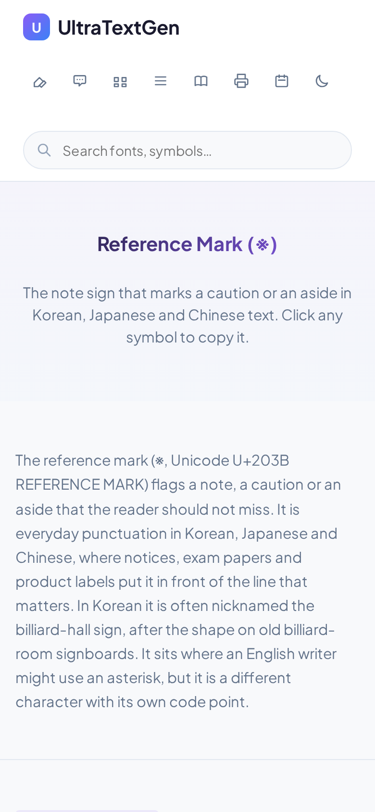

# Language-neutral intents — test report (2026-11-14)

**Production state:** `ychowdhrey/ultratextgen` @ `9d7440b5cf` (`main`, the base every run below diffs against)
**Branch under test:** `claude/practical-archimedes-luz26v` (commits `3cf0b5103b` … `fd5878ecec`)
**Model:** [`../../language-neutral-intents.md`](../../language-neutral-intents.md)
**Environment:** Linux container, Node v22.23.4, Python 3.13.18, Playwright Chromium (`/opt/pw-browsers`).
`cairosvg` and `fonttools` were installed into the container for the page-art step; CI installs its own.

Every fixture below was built in a throwaway git worktree on a local branch that was **never pushed**. No test page exists on
the site, in this branch or in its PR.

## 1. Baseline

| Run | Command | Result |
|---|---|---|
| `main` before any change | `python3 scripts/run-ci-gates.py --base main` | **106 of 106 gating checks pass** |

## 2. Unit tests (CI-gated as `intent_clusters_tests`)

`npm run test:intent-clusters` = `node scripts/lib/intent-clusters.test.js` (48 assertions) then
`python3 scripts/lib/canonical_intents.test.py` (14 assertions). Both run on throwaway fixture trees except scenario H, which
reads the real tree without writing to it.

| Scenario | What is asserted | Result |
|---|---|---|
| A English-first regression | en + ko + fr family: one cluster keyed `legacy:<en path>`, EN representative and x-default, translation passes on the Core mirror path with no ledger and no exception, legacy cluster map unchanged | 5/5 pass |
| B Korean-first publication | ko page alone, registered: own cluster, registry id, `library/*` Core → mirror, no x-default, no English member expected, no exceptions file exists or is read; the same page unregistered fails `unregistered-intent`; a missing registry is UNKNOWN | 7/7 pass |
| C Korean-first → English | id unchanged; ko URL and both canonicals unchanged; ko stays origin and representative; English becomes x-default by policy only; reciprocal hreflang; a later fr page classifies through the English member; registry still valid | 6/6 pass |
| D Japanese-first, many siblings | seven publication orders (ja; ja→ko; ja→ko→fr; ja→ko→fr→en; ja→en; ja→en→fr→ko; ja→fr→en→ko): one cluster, same id, ja representative, x-default none until English exists; `primaryLocale` moves the representative without moving the id | 8/8 pass |
| E Genuinely locale-specific | exists with no English page; clears the gate on a recorded pre-build check like any root-lane page; a sibling in another language is refused until reclassified; `inapplicableLocales` (Ñ in English) blocks a page | 4/4 pass |
| F Missing English demand | Korean page valid and unblocked; nothing creates, expects or schedules English | 2/2 pass |
| G Duplication prevention | second ko page in a cluster → `duplicate-claimant`; recorded `localeOwners` → `intent-already-served`; one id on two unconnected clusters → `pages-span-clusters`; reused id / page pinned twice; an English-less page naming two English clusters is never merged | 5/5 pass |
| H Existing-site regression (real tree) | registry has no errors/unknowns; 0 unregistered clusters; every one of the 721 English-first clusters keeps its EN id, EN representative, EN x-default; heart-symbols, euro-sign and a ko library page resolve as before; every retired exception has a `migratedTo` record | 7/7 pass |
| I Downstream | x-default policy; lane map learned from the site (`fr/imprimables`, `ja/purinto` → `printables`); fingerprint identity for English-less clusters (and the old blind spot reproduced without it); placeholder English-homepage claims make no edge | 4/4 pass |
| Python read side + spec checker | record lookup, reference page, x-default; `check_locale_spec.py` accepts a registered ko-first spec, refuses an unregistered one and a self-pointing x-default, compares a sibling against the record's reference page | 14/14 pass |

**Mutation probes** (each rule broken, suite re-run, file restored byte-identical):

| Broken rule | Suite |
|---|---|
| bridge guard removed (English-less page may merge two English clusters) | red, 1 failing |
| x-default falls back to the origin page | red, 6 failing |
| `localeOwners` ignored | red, 1 failing |
| unregistered English-less page passes | red, 1 failing |
| registry ignored entirely | red, 21 failing |
| `check_locale_spec.py` stops requiring a record | red |

## 3. End-to-end: a Korean-first page through the real pipeline, then English

Intent chosen because nothing served it: **※ reference mark** (참고표, "당구장 표시"). It is one tile inside
`ko/library/munjangbuho-giho/`; no Korean or English single-symbol page existed (directory listing of `symbol/` and
`ko/symbol/`, grep for ※ across both lanes).

| Step | Command / action | Result |
|---|---|---|
| 1 Discover | owner search across `symbol/`, `ko/symbol/`, `library/`, `ko/library/` | no page serves the single-symbol intent |
| 2 Register | record `find-and-copy-a-symbol/reference-mark`, `originLocale: ko`, `scope: cross-language` | `check:canonical-intents` exit 0 |
| 3 Eligibility | `node scripts/check-locale-parent-tier.js ko/symbol/chamgopyo-giho ko` | classified by its own lane as `symbol/*` (Core), ko tier 2 → **mirror, no ledger entry** |
| 4 Build | spec `ko-reference-mark.json` (hreflang: ko only) → `generate_library_page_from_spec.py`; hub entry in `ko/symbol/index.html` | page written; the generator's own mesh hook ran; head = canonical + self-reference, **no x-default invented** |
| 5 Assets | page art, static footer, sitemap, `llms.txt`, search index | art rendered; page in `sitemap.xml`, in `ko/symbol/llms.txt` under its lane, in `js/search/index/ko.json` |
| 6 Canonical / hreflang | `check:hreflang`, `check:hreflang-completeness`, `check:locale-mesh` | pass |
| 7 CI gates | `python3 scripts/run-ci-gates.py --base e2e-base` (all 108) | **106/108**; then 11/11 on the affected set (below) |
| 8 English demand appears | `intent-reconcile.py run` before / after a simulated Fresh `reference mark symbol` = 1,300/mo (US) | before: `en` = `no-evidence → none`; after: `en` = `meaningful-demand → expand` |
| 9 Add English | spec `reference-mark.json` → generator; `node scripts/sync-locale-mesh.js --fix --files symbol/reference-mark/index.html`; hub entry; peer and collection links | one invocation added `hreflang="en"` and the policy x-default to the Korean page |
| 10 Re-run | all 108 gates | see §3.2 |
| 11 Stability | publication view and diffs | see §3.3 |

### 3.1 Phase 1 (Korean only): the two failures, and why neither is architectural

1. `symbol_collection_link`: the gate recognised the page as a **registered origin page** (it previously returned UNKNOWN,
   exit 2, for any locale symbol page without an English parent) and asked for the locale's collection line. Fixed by the normal
   last-mile step `npm run sync:symbol-collection-link`, which links the Korean library hub.
2. `gate_inventory`: the branch had added two gates without regenerating `docs/README.md`. Fixed on the branch (`0a38256469`).

Re-run of the affected set, `--only symbol_collection_link gate_inventory locale_parent_gap locale_spec hreflang
hreflang_completeness locale_mesh canonical_intents intent_clusters_tests parity library_hub_coverage`: **11/11 pass**. The gap
gate's own line:

```
New pages with no English member (passed: canonical intent registered, gate cleared):
  ✓ ko/symbol/chamgopyo-giho/index.html  intent find-and-copy-a-symbol/reference-mark  (classified as symbol/chamgopyo-giho → mirror)
```

### 3.2 Phase 2 (Korean + English)

All 108 gates: **107/108** on the first run. The one failure, `spec_sentence_reuse`, was the test fixture's English tagline
reusing a stock sentence ("Click any symbol to copy it.") that the gate rightly refuses; rewritten through the generator.
Re-run (fixture commit `8bf7ccfcba`): **108/108 pass**, exit 0.

A defect the end-to-end found, fixed on the branch (`4a2abf8f94`): adding a cluster's first English sibling needed **two**
`sync:locale-mesh --fix` runs, because one `audit-hreflang --fix` pass computes the expected x-default from the tree as it was
before the pass added the English link. `sync-locale-mesh.js` now repeats the repair until it writes nothing (at most three
passes); the second e2e run converged in one invocation.

### 3.3 Stability after adding English (step 11)

| Check | Phase 1 → Phase 2 |
|---|---|
| canonical intent id | `find-and-copy-a-symbol/reference-mark` → unchanged |
| Korean URL and `<link rel="canonical">` | `/ko/symbol/chamgopyo-giho/` → unchanged |
| English canonical | self (`/symbol/reference-mark/`) |
| origin / representative | `ko` / the Korean page → unchanged |
| x-default | none → English page (`policy:en`), on both pages |
| Korean page diff | + `hreflang="en"`, + x-default, collection line now the Korean punctuation collection, one peer link |
| `_redirects`, `_routes.json`, `functions/` | 0 files changed |
| `sitemap.xml` | both URLs present |
| Korean page render, 390 px | **byte-identical** screenshot before and after |

### 3.4 Japanese-first and French-first

`ja/symbol/odoriji/` (踊り字 々 〃 ゝ, `find-and-copy-a-symbol/iteration-marks`) and `fr/symbol/barre-oblique/` (/ and \\,
`find-and-copy-a-symbol/slash`), each registered, built by the generator with a self-reference only, hub entries added,
collection links synced, whole-tree artifacts regenerated (fixture commit `f1a83cab5d`). All 108 gates: **108/108 pass**.
The gap gate's own lines:

```
  ✓ fr/symbol/barre-oblique/index.html  intent find-and-copy-a-symbol/slash  (classified as symbol/barre-oblique → mirror)
  ✓ ja/symbol/odoriji/index.html  intent find-and-copy-a-symbol/iteration-marks  (classified as symbol/odoriji → mirror)
```

## 4. Rendered pages

Chromium, ads and tag scripts blocked, viewport 390×844 (mobile) and 1280×900 (desktop); first tile clicked and the clipboard
read back.

| Page | Phase | Overflow (390 / 1280) | Tiles | First tile copies | JS errors |
|---|---|---|---|---|---|
| `ko/symbol/chamgopyo-giho/` | 1 | none / none | 10 | `※` | 0 |
| `ko/symbol/chamgopyo-giho/` | 2 | none / none | 10 | `※` | 0 |
| `symbol/reference-mark/` | 2 | none / none | 10 | `※` | 0 |

 

## 5. Real content, read-only (no file changed)

`buildIntentModel()` on the live tree, plus the admission rule applied to an existing page as if it were new:

| Case | Page | Intent | Languages | Representative | x-default members correct | Admission if new |
|---|---|---|---|---|---|---|
| English-first family | `library/heart-symbols/` | `legacy:library/heart-symbols` | 20 | EN | 20/20 | `fr` sibling: pass (mirror) |
| Migrated locale-only page | `ja/gal-moji/` | `write-in-gal-moji` (locale-specific) | 1 | itself | 1/1 (site root, recorded) | gated: root-lane page needs a pre-build check, the same bar as a translation of an unclassified root page |
| Korean library page | `ko/library/chess-gihou/` | `legacy:library/chess-symbols` | 17 | EN | 17/17 | pass (mirror) |
| Symbol page | `symbol/euro-sign/` | `legacy:symbol/euro-sign` | 19 | EN | 19/19 | n/a |
| English-less multilingual cluster | `fr/changeur-de-police/` + `it/font-copia-e-incolla/` | `style-text-to-stand-out/font-changer` | 2 | fr | 2/2 (site root, recorded) | gated, as above |

`check:hreflang` and `check:hreflang-completeness` on the real tree: 0 issues; the completeness audit now also covers the 5
multilingual clusters with no English member (0 missing entries). `check:locale-spec` on all 308 real locale specs: output
byte-identical to the pre-change script.

## 6. Existing-site regression on the branch itself

`python3 scripts/run-ci-gates.py --base main` on the branch (no fixtures), at `fdbdbe7add`: **108/108 pass**, exit 0. The 106 gates that existed before pass unchanged; the two new ones (`canonical_intents`, `intent_clusters_tests`) pass.

## 7. What this does not test

- Search engines' reading of the new pages: nothing here was published.
- The monthly reconciliation's GitHub Actions run: tested locally (22 tests, a real-data run, a byte-identical re-run); the
  workflow first runs on its schedule.
- Legacy shapes kept as they were (site-root x-default on migrated pages, five out-of-cluster x-defaults, one `hreflang="en"`
  homepage placeholder): recorded and reported as warnings, not rewritten.
